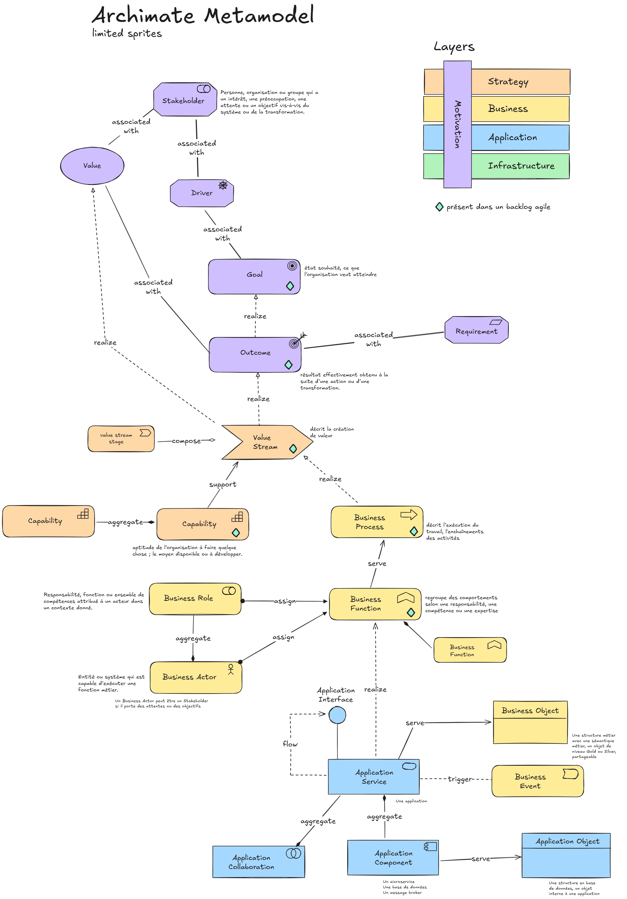

# archimate-excalidraw

A skill for producing ArchiMate 3.2 diagrams in Excalidraw with consistent notation, colors, and reusable sprites.

## Scope

- ArchiMate element usage for the supported Motivation, Strategy, Business, Application, and Technology concepts
- Relationship usage through predefined relationship sprites
- Layer color palette and visual consistency rules
- Reuse-first modeling using the provided sprite library

This skill defines diagram conventions only. It does not define software architecture, implementation, testing, or deployment rules.

## Assets

- `SKILL.md` — authoritative instructions and constraints
- `sprites/` — reusable ArchiMate element and relationship sprites
- `full-example.excalidraw` — complete reference example

## Usage

Use this skill when creating or updating ArchiMate diagrams in Excalidraw.
The rules in [SKILL.md](SKILL.md) define which elements and relationships are allowed, how sprites must be reused, and which colors apply per layer.
